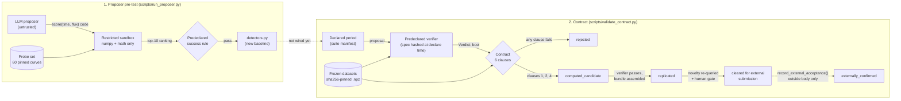
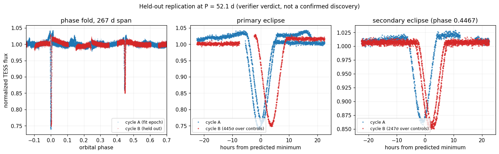

# Hallmark

**Fail-closed verification for LLM-proposed science.** Two pieces, each demonstrated on frozen public astronomy data (TESS light curves, with Gaia DR3 and AAVSO VSX cross-checks): an LLM writes executable detectors that are judged by a rule fixed before any model call, and a contract promotes a claimed period only if a verifier declared *before* the result exists says so. No model judgment sits anywhere in the promotion path. The two pieces are not yet wired into one automatic pipeline (see Status).

> A finding is not real until a body that is causally independent of us says so.

## Why this is interesting

LLMs are good at proposing analyses and bad at grading their own output. Most "AI scientist" pipelines let the same kind of model that wrote the analysis also judge it. That gives you confident, unfalsifiable output. Hallmark separates the two halves:

- **The proposer is free.** It writes `score(time, flux)` detectors and critiques other proposals. Its output is untrusted data, scored only by a predeclared rule.
- **The verifier is not.** It is plain deterministic Python, named and hashed before the candidate is computed (changing any parameter changes the hash, which invalidates the declaration). It returns a `bool`. A graded score, an "INDETERMINATE", or a missing input all fail closed.
- **Promotion is a state machine with an append-only audit log.** `proposal -> computed_candidate -> replicated -> externally_confirmed`. A candidate id is declared once, so a rejected candidate cannot be reopened under a friendlier verifier. The last state is written only through `ledger.record_external_acceptance()`, which requires an acceptance record from an outside body (here, the human moderators of the AAVSO VSX catalogue); the contract code never calls it. The code can clear a candidate for submission. It cannot award itself the hallmark. (The ledger is a plain SQLite file: these rules bind the code, not someone editing rows by hand.)

The test that matters is the kill criterion: **if any null control promotes, the contract is broken.** The repo ships the null suite (quiet stars plus real light curves where data gaps and spacecraft artifacts produce discovery-shaped dips) so you can check that yourself.

## Architecture

Two halves, each tested on its own. Nothing in the repo yet feeds the proposer's output into the contract: the periods the verifiers test come from the suite manifest (`suites/manifest.py`).



The six clauses (`hallmark/contract.py`):

| # | Clause | Checked how |
|---|---|---|
| 1 | Frozen dataset, pinned by hash | re-hash the `.npz`, compare to the pin |
| 2 | Executable code computes the result | the module resolves; its source hash is recorded |
| 3 | Novelty against a *named* catalogue | live AAVSO VSX cone query; a failed query is "not checked", never "absent" |
| 4 | Verifier predeclared | verifier name and spec hash written at `declare()` (and into the audit log), re-checked against the verdict; a candidate id cannot be re-declared |
| 5 | Reproducibility bundle | data hash, code ref, parameters, outputs, falsification attempts |
| 6 | Mechanical promotion | raises `ContractViolation` if any clause returns a non-`bool` |

Verifiers (`hallmark/verifiers/`):

- **`held-out-ephemeris`**: leave-one-eclipse-out. Fit `(P, t0)` on the other eclipses, predict the held-out one, compare against control phases. Needs at least 4 clean events, because two events admit `P = interval / k` for every integer `k`.
- **`proposed-ephemeris-held-out`**: takes a proposed period, fits only the epoch on the first 60% of the baseline, and tests the prediction on the held-out 40%.
- **`southern-archival-ephemeris`**: same idea across two TESS visits separated by a gap. Excludes a secondary eclipse from the controls *only if* that secondary itself replicates in the held-out block, so nulls never get the exclusion.
- **`held-out-curve-fit`**: for claims about form, not objects (a sech² eclipse profile). Alternating-point split, must beat the declared prior model on held-out data.

Gap artifacts are handled mechanically: events within a guard window of a data gap or segment edge are dropped before fitting, and a dip tied to the spacecraft clock does not recur where a stellar ephemeris predicts it.

## Quickstart

Python 3.10+. The frozen validation suite (about 6 MB of public TESS data) ships in `data/frozen/`, so everything below runs offline.

```bash
git clone https://github.com/nmcbride-42/hallmark && cd hallmark
python -m venv .venv && . .venv/bin/activate
pip install -e ".[dev]"

pytest                                     # offline tests, a few minutes on 2 cores
python scripts/validate_contract.py        # full validation, exit code is the verdict (~2-3 min)
python scripts/example_southern_candidate.py   # one proposal, one verifier, one verdict, plus alias checks
```

Optional extras:

```bash
pip install -e ".[fetch]"                  # lightkurve, to re-freeze data from MAST
python -m suites.freeze                    # rebuild the frozen suite (idempotent)
python scripts/fetch_probe_set.py          # download the 60-curve detector probe set
python scripts/score_detectors.py          # score the absorbed detectors on it
python scripts/run_proposer.py --proposals-file examples/first_round_proposals.json

pip install -e ".[llm]"                    # call a model as the proposer
export ANTHROPIC_API_KEY=...               # see .env.example
python scripts/run_proposer.py --provider anthropic
python scripts/validate_contract.py --live     # also re-query VSX for clause 3
pytest --run-network --run-slow            # network and end-to-end tests
```

## What is measured, and how

**Contract validation** (`scripts/validate_contract.py`, reproducible from this repo). Every candidate in four frozen suites goes through the contract. The verifiers never see suite labels, which are applied only after all verdicts are recorded. They do see a proposed period: each catalogued positive is tested with **its catalogued period** as the proposal (the same value used as ground truth), and each null is tested with every one of those periods. So the positive rows measure the verifier when it is handed a correct period, not an end-to-end pipeline that has to find the period itself. Output of the shipped version:

| Regime | Replicated / total |
|---|---|
| Short period (1.7 to 2.1 d), deep to shallow, catalogued | 3 / 3 |
| Injected box signals in real quiet light curves (1.5, 2.5, 5.0 d; 1 to 5% depth) | 3 / 3 |
| Mid period (8.1 d, deep secondary), catalogued | 1 / 1 |
| Long period on a single TESS visit (18.5 d, 27.1 d), catalogued | **0 / 2**, both INDETERMINATE |
| **Known positives, total** | **7 / 9** |
| **Null controls: quiet stars (4) and gap/momentum-dump artifacts (6)** | **0 / 10 promoted** |
| *Not a known positive:* the unconfirmed candidate TIC 220481009, two TESS visits, declared 52.1 d | replicates (see the worked example) |

The script reports the candidate on its own line, not as a known positive: it is not ground truth. (Its pass criterion 1 is still that the candidate reaches `replicated`, which is a check that the submission path works, not evidence that the candidate is real.)

- Each null also faces every proposed period in the suite under two verifiers, plus the leave-one-out verifier: 15 promotion attempts per null, 150 in total, none promoted.
- All 49 verdicts are replayed on identical inputs and reproduce exactly.
- The two long-period misses are the contract working as designed: one TESS visit cannot over-determine an 18 to 27 day ephemeris, so the verifier refuses rather than guesses.
- The model-fit claim (sech² eclipse profile) reaches `replicated` with held-out R² 0.978 against a declared prior of 0.958, and stops there, because clause 3 does not apply to a claim about form. An independently refitted double Gaussian scores 0.979 on the same held-out points, so the simpler form appears to do as well. The verifier tests the claim as it was made; it does not decide which model is best.

**Limitations.** The suites are small (9 known positives, 10 nulls, 1 unconfirmed candidate), chosen to span regimes rather than to estimate population rates, so per-regime counts here are smoke tests, not precision/recall estimates. Recall assumes an oracle period, as above. The cross-visit verifier accepts period aliases (next section), so a pass confirms recurrence, not the exact period. The six real positives are catalogued variables and the three injected ones are synthetic signals in real noise; the uncatalogued population may skew toward long periods, where this pipeline is weakest.

**Proposer pre-test** (reported historical result; reproducible with `scripts/fetch_probe_set.py` then `scripts/score_detectors.py`). Probe set: 60 TESS light curves, one sector each, of which 20 are members of the TESS eclipsing-binary catalogue (Prša et al. 2022) that an earlier survey's detector had missed, and 40 are controls. Success rule, fixed before any model call: at least 7 of 10 catalogued EBs in a transform's top 10 (hypergeometric p of about 0.012) **and** strictly more than the baseline. Results:

| Detector (all LLM-written, now absorbed as plain code) | Top 10 | p |
|---|---|---|
| `lomb_scargle_peak` | 7 / 10 | 0.012 |
| `string_length_min` | 8 / 10 | 0.0014 |
| `acf_secondary_peak` | 8 / 10 | 0.0014 |
| `composite_eb_score` (later proposer/critic round) | 9 / 10 | 9.2e-5 |

`scripts/score_detectors.py` reproduces these top-10 counts from the pinned probe set (about 15 CPU-minutes on two cores). `composite_eb_score` also puts 15 of 20 positives in its top 20 (p = 2.5e-6).

At the time, the original survey detector's stored scores put 6 / 10 in the top 10 of the same probe set. Those scores are not part of this repo, so that comparison is reported, not reproducible here. A passing transform is not trusted because it passed. It is reviewed, versioned into `hallmark/detectors.py`, and becomes the baseline the next proposer has to beat. Detectors only rank candidates, and their period estimates are often aliases. The verifier decides whether a declared ephemeris recurs in held-out data; it does not settle which alias is the true period either.

**The worked example.** TIC 220481009, an unconfirmed long-period detached eclipsing-binary candidate at Dec −58°, with a declared period of 52.1 d (`suites/manifest.py`). Its single 76-day TESS visit is INDETERMINATE (too few eclipses). Across two visits 110 days apart, the southern-archival verifier fits only the epoch on the first visit and predicts the primary eclipse in the held-out second visit at 445σ over control phases; an eccentric secondary at phase 0.447 also replicates. A 6-decimal period (52.144497 d) was later refined for the catalogue submission on the combined multi-cycle data, so the second visit is not held out from it; its higher score (641σ) is partly circular and is not quoted as evidence.

What the pass does **not** show is the period. With two primary eclipses per visit, other periods also line up with real eclipses. On the shipped archive the same verifier also passes at 2P (104.2 d, 244σ), at P/2 and P/5 of the refined period (26.072 d, 257σ; 10.429 d, 148σ), and at one unrelated period we tried (60.0 d, 136σ), while 20, 37, 45, 59, 61, 70 and 80 d fail. So a pass says *real eclipses occur in the held-out visit where the declared ephemeris puts them*. It does not establish the period: P versus 2P or P/2 is not resolved by this verifier and needs more eclipse timings, and the 60 d case shows a non-alias period can occasionally land on enough eclipse to pass. The null suite tests whether noise and artifacts can pass; it does not test whether a wrong period on a real eclipsing binary can. `scripts/example_southern_candidate.py` prints the alias checks, and `tests/test_verifiers.py` pins this behaviour. **This is a verifier verdict, not a discovery.** A VSX submission based on it is pending human moderation and is not confirmed.



*Generated by `scripts/example_southern_candidate.py --plot` at the declared 52.1 d. The held-out eclipses land a few hours after the predicted minimum, which is what a slightly imprecise declared period looks like across a 267-day span; the verifier's tolerance accepts it.*

## Layout

```
hallmark/
  contract.py        six clauses -> three transitions; fail-closed
  ledger.py          SQLite state machine, append-only transitions, bundles
  verifier.py        VerificationHandle + bool-only Verdict
  hashing.py         the one dataset-hash function (producer and checker agree)
  feasibility.py     pre-declaration gate: can this verifier resolve the claim at all?
  inventor.py        proposer plumbing: restricted exec, parsing, predeclared rule
  detectors.py       versioned LLM-free detector library (absorbed proposals)
  mast.py            TESS SPOC light-curve fetch (lightkurve or direct MAST)
  verifiers/         ephemeris, southern_archival, curvefit, novelty (VSX)
suites/              manifest of the frozen positive/null/injected/adversarial suites
scripts/             validate_contract, example_southern_candidate, run_proposer, ...
data/frozen/         sha256-pinned TESS light curves + index.json
data/probe_set/      probe-set pins and labels (curves fetched on demand)
examples/            the first-round LLM proposals, verbatim
docs/design.md       design notes and the failure modes that shaped them
```

## Configuration

All optional. See `.env.example`.

| Variable | Default | Purpose |
|---|---|---|
| `HALLMARK_DATA_DIR` | `./data` | frozen datasets, probe set, download cache |
| `HALLMARK_DB` | `$HALLMARK_DATA_DIR/hallmark.db` | ledger path for library use (validation uses a temp ledger) |
| `ANTHROPIC_API_KEY` | unset | only for `run_proposer.py --provider anthropic` |
| `HALLMARK_LLM_MODEL` | `claude-opus-5-5` | model for the proposer |

**Sandbox warning.** `hallmark.inventor.run_transform` restricts builtins and imports and enforces a wall-clock limit. That guards against accidents, not attacks: Python `exec` cannot be made safe against adversarial code. Run proposals from a model or person you do not control inside a container or VM.

## Status

Research prototype. The contract, verifiers, and validation suite are complete and tested. The proposer loop has been run (results above) but the live-model path in `run_proposer.py` is a thin adapter that the offline test suite does not exercise. **Not implemented:** feeding proposer output (a detector's top candidates and its `estimate_period()` result) through `declare -> to_computed_candidate -> verify`; today the contract tests periods declared in the suite manifest. Period-alias resolution is also not implemented (see the worked example). External confirmation, the step that matters most, depends on catalogue moderators and is pending. Nothing produced by this code is a confirmed discovery.

## How it was built

Designed by Nick McBride and built with his AI agent Iris (Claude-based) as part of a personal research platform.

## Data and credits

TESS data from the Mikulski Archive for Space Telescopes (MAST), SPOC 2-minute light curves (Ricker et al. 2015). Gaia DR3 (Gaia Collaboration 2023). AAVSO International Variable Star Index (VSX). TESS eclipsing-binary catalogue (Prša et al. 2022). ASAS-SN Sky Patrol. Light-curve access via lightkurve when installed.

MIT License. See `LICENSE`.
